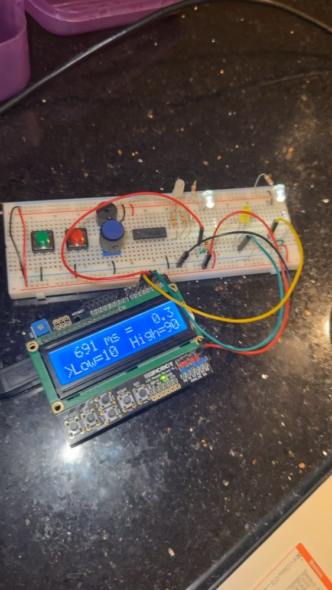

# Dual-Sensor Speed Trap System

Embedded C speed-measurement prototype built around an AVR microcontroller, dual optical sensors, and a hardware feedback interface.

---

## Demo

[Download Demo Video](https://github.com/isaismarrufo/dual-sensor-speed-trap/raw/refs/heads/main/media/demo.mp4)

Visual-only recording of the optical sensors, timing indicator, and LCD in operation.



---

## Overview

Developed from October to December 2025, this project combines interrupt-driven sensing, hardware timers, and direct register control to measure the travel time of an object between two optical sensors. The interface presents elapsed time and speed, lets the user adjust speed limits, and provides visual and audible feedback.

The project focuses on low-level firmware, peripheral integration, and hardware/software debugging on a physical embedded system.

---

## Features

- Dual optical sensors for object detection and elapsed-time measurement
- Timer and interrupt-based measurement control with timeout handling
- LCD interface for timing, speed, and limit settings
- Rotary encoder and buttons for adjusting the speed range
- EEPROM storage for settings across power cycles
- Servo indicator, RGB status LED, and buzzer feedback
- Integer arithmetic for speed calculations
- Modular C firmware organized by application, interrupts, initialization, and device control

---

## Hardware

- ATmega328P AVR microcontroller on an Arduino Uno platform
- Two optical sensing pairs using LEDs and phototransistors
- Character LCD
- Rotary encoder and selection buttons
- Servo motor
- RGB LED and timing indicator
- Buzzer
- Breadboard, resistors, and jumper wiring

---

## Engineering Focus

- Embedded C and direct access to microcontroller registers
- GPIO, timer interrupts, and pin-change interrupts
- PWM and peripheral timing
- Nonvolatile settings and user input handling
- Multi-file builds with the AVR toolchain and Makefiles
- Hardware debugging using an oscilloscope and digital multimeter

---

## Tools Used

- C
- AVR-GCC and AVR-LibC
- Make and AVRDUDE
- Oscilloscope and digital multimeter
- Git and GitHub

---

## Repository Contents

```text
media/          Hardware photo and visual-only demo
README.md       Project overview and engineering highlights
```

Firmware, course-provided drivers, assignment documents, and test binaries are retained separately in a private repository to respect course publication restrictions. This public showcase contains the project overview and demonstration assets.
